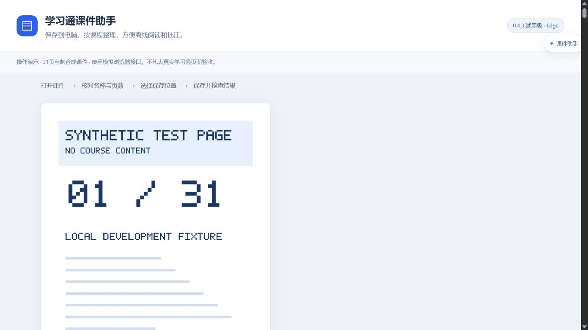
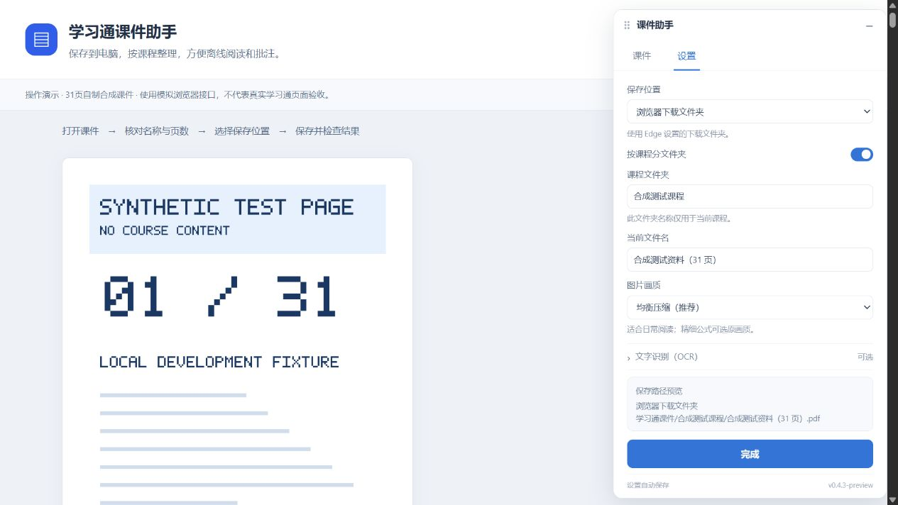

# 学习通课件助手

**将你已打开的学习通课件保存到电脑，按课程整理，方便离线阅读和批注。**

用于 **Windows 上的学习通课件保存**。当前公开试用版 **0.4.3**，Edge 已有实机保存记录，Chrome 可用同一安装包参与验证，实际保存仍待验收。免费使用；普通保存无需 Python、Node.js 或 OCR 服务。

[**下载安装包**](https://github.com/Atetra2007/chaoxing-study-helper/releases/download/v0.4.3/chaoxing-study-helper-0.4.3.zip) · [**安装教程（Edge / Chrome）**](docs/安装使用说明.md) · [**版本说明**](https://github.com/Atetra2007/chaoxing-study-helper/releases/tag/v0.4.3) · [**反馈问题**](https://github.com/Atetra2007/chaoxing-study-helper/issues/new/choose)



*演示使用项目生成的合成课件和模拟浏览器接口，展示实际界面组件的操作流程；不包含私人课程资料，也不作为真实学习通或 Edge 扩展验收证据。*

## 能帮你做什么

- **保存当前课件**：优先使用可正常访问的原文件；只有分页图片时，按页合成 PDF。
- **按课程整理**：指定保存文件夹，按课程归档；也可直接保存到所选目录。
- **查看进度与补存**：支持暂停、继续、失败页重试；收起小窗后保存继续。
- **检查保存结果**：已知缺页、页数冲突或加载失败时阻止导出。指定目录写入后读回校验，浏览器下载则等待实际完成。
- **选择画质**：提供均衡压缩和原画质；可选本机 OCR 为适合的文字页生成可选文字的 PDF。

图片合成的 PDF 可以阅读和批注，不能还原可编辑 PPT、动画或原始矢量图。无明确总页数时，助手会标明仅依据阅读器列出的页面，不能保证来源整份完整。

## 三步开始

1. 在[版本发布页](https://github.com/Atetra2007/chaoxing-study-helper/releases/tag/v0.4.3)下载 **`chaoxing-study-helper-0.4.3.zip`**，解压到固定文件夹。
2. 打开浏览器扩展管理页：Edge 输入 `edge://extensions`，Chrome 输入 `chrome://extensions`。开启“开发人员模式 / 开发者模式”，点击“加载解压缩的扩展 / 加载已解压的扩展程序”，选择**直接包含 `manifest.json` 的文件夹**。
3. 正常登录学习通并打开一份 PPT/PDF 课件，打开“课件助手”，核对名称、页数和保存位置后点击保存。

下载的是扩展 ZIP，无需安装开发环境。发布页的 `Source code` 是开发源码，`promo.zip` 是推广素材，都不是安装包。两个浏览器需分别安装、登录和授权保存目录。完整步骤、更新方法及首次保存检查见[安装教程](docs/安装使用说明.md)。



## 支持范围与试用状态

| 项目 | 当前状态 |
| --- | --- |
| Windows + Edge 116及以上 | 已有实机保存记录，建议使用最新版 Edge |
| 指定文件夹、按课程保存 | 0.4.3已有真实操作成功反馈及28页实际PDF检查记录 |
| 页内小窗 | 部分实际页面出现加载超时，可主动使用“独立小窗打开” |
| Windows + Chrome 116及以上 | 可按安装教程参与验证；尚未完成真实扩展保存验收 |
| macOS、其他阅读器 | 尚未完成真实兼容验收，不承诺可用 |
| 本机 OCR | 可选试验功能，默认关闭；需要额外准备，识别结果需核对 |

保存期间请保留原课件标签页。刷新、导航、关闭来源页或重启浏览器后，不能继续原任务。当前限制为500页、单页25MiB、总图片250MiB。

**仍待验证**：重启后的目录授权恢复、真实同名文件保护、关闭课程分组后的真实目录保存等。历史版本曾发生选目录后 Edge 关闭，0.4.3调整后的授权与保存已成功，但此前崩溃的唯一根因尚未确定。详细证据与剩余项见[开发进度](docs/进度.md)和[0.4.3修复记录](docs/修复记录-0.4.3.md)。

## 隐私与使用范围

课件处理在本机进行；本扩展没有自建云端上传或统计服务。它会请求学习通及其课件图片域名，启用 OCR 时还会连接本机组件。权限、保存记录及清理方式见[隐私与权限说明](PRIVACY.md)。

这是独立开发的非官方工具，与超星/学习通无隶属关系。仅用于你有权访问和保存的资料；不提供课程账号、课件内容、刷课、答题或访问权限绕过功能。演示使用自制合成资料。

## 反馈与参与

遇到问题请[提交反馈](https://github.com/Atetra2007/chaoxing-study-helper/issues/new/choose)，说明扩展版本、浏览器名称和版本、操作步骤及提示文字。截图请遮挡姓名、学号、学校、课程链接和课件正文；不要上传 Cookie、连接文件或带登录参数的地址。

欢迎先用一份短课件试用，再核对总页数、顺序和清晰度。可以参考[试用反馈清单](docs/试用反馈.md)。

## 本地开发

需要 Node.js 24、pnpm 11.19.0；打包发布 ZIP 另需 Python 3。普通用户无需这些环境。

```sh
git clone https://github.com/Atetra2007/chaoxing-study-helper.git
cd chaoxing-study-helper
pnpm install --frozen-lockfile
pnpm test
pnpm build
pnpm preview
```

构建位于 `outputs/chaoxing-study-helper-0.4.3/`。预览地址 `http://127.0.0.1:4178/demo` 使用合成数据；开发故障场景见 `/floating?test=failure`。预览不代替真实扩展的权限和课件保存验证。

`pnpm package` 构建并生成发布 ZIP 和 SHA-256 校验文件。`pnpm update:local` 可备份、校验并更新本机固定安装目录；更新后需在安装助手的浏览器中重新加载扩展。可选 OCR 准备见[本地 OCR 使用说明](docs/本地OCR使用说明.md)。

自动检查运行于 GitHub Actions；Actions 临时构建保留14天，对外下载请使用 Releases。`work/`、`outputs/`、课件及个人笔记不进入源码仓库。

[更新记录](CHANGELOG.md) · [开发进度](docs/进度.md) · [需求与验收](docs/需求.md) · [贡献指南](CONTRIBUTING.md) · [第三方组件](THIRD_PARTY_NOTICES.md)

## 许可证

本项目代码以 [MIT 许可证](LICENSE)发布。第三方库、OCR模型和用户保存的课件分别遵循其原有许可与权利归属。
